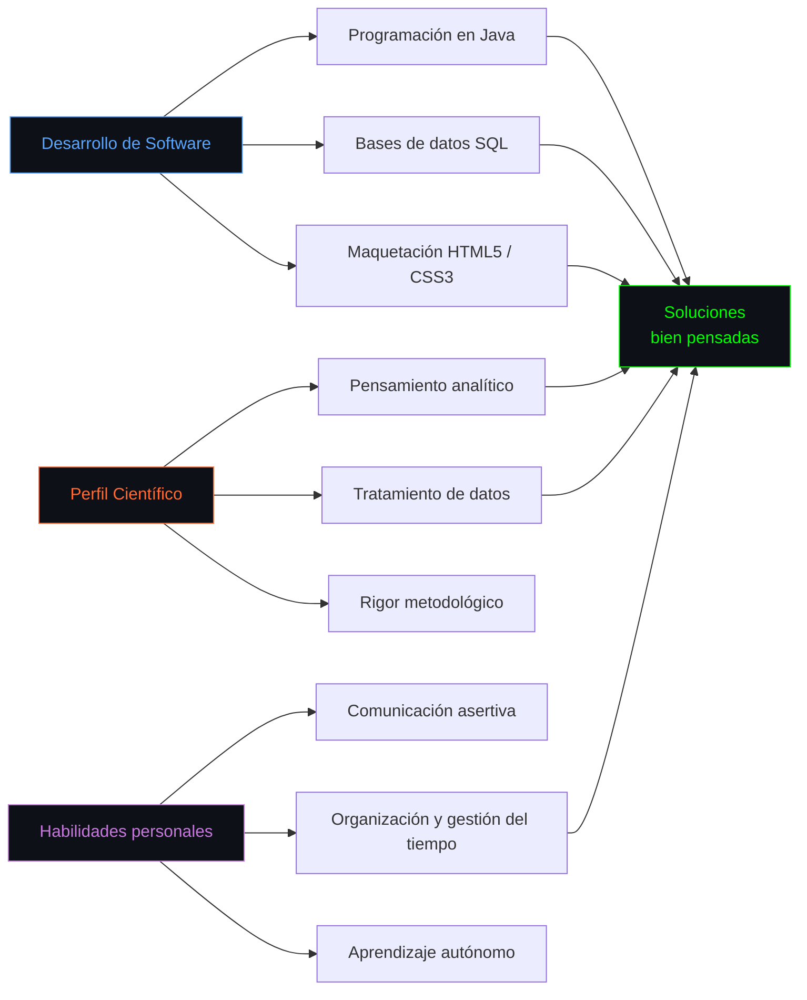
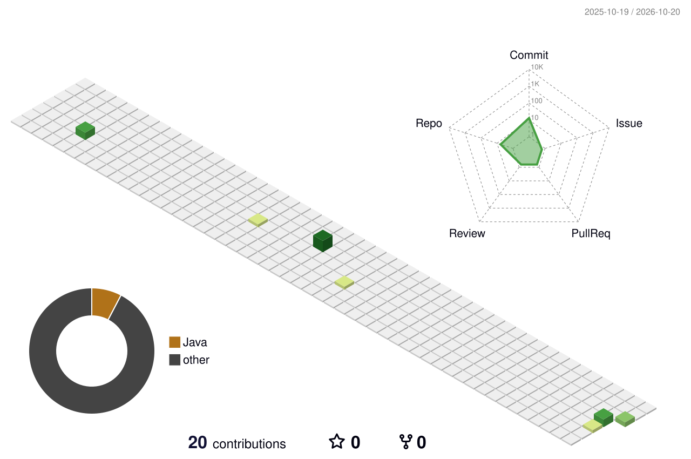

<p align="center">
  
</p>

<p align="center">
  
  &nbsp;&nbsp;
  <a href="https://github.com/ari2dev?tab=followers"></a>
  &nbsp;&nbsp;
  <a href="https://github.com/ari2dev?tab=repositories"></a>
</p>

<div align="center">


</div>

<!-- ━━━━━━━━━━━━━━━━━━━━━━━━━━━━━━━━━━━━━━━━━━━━━━━━━━━━━━━━ -->

<p align="center">
  <picture>
    <source media="(prefers-color-scheme: dark)" srcset="./dark.svg">
    <source media="(prefers-color-scheme: light)" srcset="./light.svg">
    
  </picture>
</p>

<p align="center">
  
</p>

<!-- ━━━━━━━━━━━━━━━━━━━━━━━━━━━━━━━━━━━━━━━━━━━━━━━━━━━━━━━━ -->

##  Sobre mí

<p align="center">
  <picture>
    <source media="(prefers-color-scheme: light)" srcset="https://www.gitskins.com/api/section/about?username=ari2dev&theme=github-dark&mode=light" />
    
  </picture>
</p>

<div align="left">

```java
public class Ariadna {

    String nombre = "Ariadna Galván Navarro";
    String rol = "Desarrolladora de software en formación";
    String estudios = "Grado Superior en DAM (2025 - actualidad) · IES Lomo de la Herradura";
    String formacionPrevia = "Biología · Universidad de Granada (2021-2025)";
    String[] idiomas = {"Castellano (nativo)", "Inglés (nivel medio)"};

    String[] tecnologias() {
        return new String[] {"Java", "SQL", "HTML5", "CSS3"};
    }

    String[] enfoqueActual() {
        return new String[] {
            "☕ Afianzando la lógica de programación en Java",
            "🗄️ Diseñando y consultando bases de datos relacionales con SQL",
            "🌐 Maquetando con HTML5 y CSS3",
            "🌱 Aprendiendo nuevas herramientas de forma autónoma"
        };
    }
}

Ariadna yo = new Ariadna();
```

```
Estudiante de Desarrollo de Aplicaciones Multiplataforma con una sólida base
científica tras varios años de Biología. Responsable, organizada y con gran
capacidad de aprendizaje. Mi formación me ha dado pensamiento analítico,
rigor metodológico y capacidad para resolver problemas bajo presión.
```

</div>

<p align="center">
  
</p>

<!-- ━━━━━━━━━━━━━━━━━━━━━━━━━━━━━━━━━━━━━━━━━━━━━━━━━━━━━━━━ -->

##  Stack tecnológico

<p align="center">
  <picture>
    <source media="(prefers-color-scheme: light)" srcset="https://www.gitskins.com/api/section/stack?username=ari2dev&theme=github-dark&mode=light" />
    
  </picture>
</p>

<div align="center">

#### Lenguajes


#### Bases de datos


#### Herramientas


</div>

<p align="center">
  
</p>

<!-- ━━━━━━━━━━━━━━━━━━━━━━━━━━━━━━━━━━━━━━━━━━━━━━━━━━━━━━━━ -->

## 🧠 Mapa de competencias



<p align="center">
  
</p>

<!-- ━━━━━━━━━━━━━━━━━━━━━━━━━━━━━━━━━━━━━━━━━━━━━━━━━━━━━━━━ -->

## 🎓 Formación

<div align="center">

| Periodo | Estudios | Centro |
|:---:|:---|:---|
| 2025 - actualidad | Grado Superior en Desarrollo de Aplicaciones Multiplataforma (DAM) | IES Lomo de la Herradura |
| 2021 - 2025 | Grado en Biología (pendiente de finalización) | Universidad de Granada |
| — | Bachillerato de Ciencias de la Salud | IES José Arencibia Gil |

</div>

<p align="center">
  
</p>

<!-- ━━━━━━━━━━━━━━━━━━━━━━━━━━━━━━━━━━━━━━━━━━━━━━━━━━━━━━━━ -->

## 🤝 Abierta a colaboración

<div align="center">

<table width="100%">
<tr>
<td align="center" width="20%">
  <picture>
    <source media="(prefers-color-scheme: dark)" srcset="https://api.iconify.design/mdi/language-java.svg?color=white">
    <source media="(prefers-color-scheme: light)" srcset="https://api.iconify.design/mdi/language-java.svg?color=black">
    
  </picture>
  <br><br>
  <strong>Desarrollo</strong>
  <br><br>
  <small>
    Aplicaciones en Java<br>
    Lógica de gestión<br>
    Aprendizaje continuo
  </small>
</td>
<td align="center" width="20%">
  <picture>
    <source media="(prefers-color-scheme: dark)" srcset="https://api.iconify.design/mdi/database.svg?color=white">
    <source media="(prefers-color-scheme: light)" srcset="https://api.iconify.design/mdi/database.svg?color=black">
    
  </picture>
  <br><br>
  <strong>Bases de datos</strong>
  <br><br>
  <small>
    Diseño relacional<br>
    Consultas SQL<br>
    Manipulación de datos
  </small>
</td>
<td align="center" width="20%">
  <picture>
    <source media="(prefers-color-scheme: dark)" srcset="https://api.iconify.design/mdi/web.svg?color=white">
    <source media="(prefers-color-scheme: light)" srcset="https://api.iconify.design/mdi/web.svg?color=black">
    
  </picture>
  <br><br>
  <strong>Web</strong>
  <br><br>
  <small>
    Maquetación HTML5<br>
    Estilos con CSS3<br>
    Interfaces claras
  </small>
</td>
<td align="center" width="20%">
  <picture>
    <source media="(prefers-color-scheme: dark)" srcset="https://api.iconify.design/mdi/chart-box-outline.svg?color=white">
    <source media="(prefers-color-scheme: light)" srcset="https://api.iconify.design/mdi/chart-box-outline.svg?color=black">
    
  </picture>
  <br><br>
  <strong>Análisis de datos</strong>
  <br><br>
  <small>
    Rigor científico<br>
    Tratamiento de datos<br>
    Pensamiento analítico
  </small>
</td>
<td align="center" width="20%">
  <picture>
    <source media="(prefers-color-scheme: dark)" srcset="https://api.iconify.design/mdi/account-group.svg?color=white">
    <source media="(prefers-color-scheme: light)" srcset="https://api.iconify.design/mdi/account-group.svg?color=black">
    
  </picture>
  <br><br>
  <strong>Trabajo en equipo</strong>
  <br><br>
  <small>
    Comunicación asertiva<br>
    Proyectos de aprendizaje<br>
    Mejora continua
  </small>
</td>
</tr>
</table>

Busco **prácticas y primeras oportunidades** en desarrollo de software · disponibilidad horaria y geográfica flexible

</div>

<p align="center">
  
</p>

<!-- ━━━━━━━━━━━━━━━━━━━━━━━━━━━━━━━━━━━━━━━━━━━━━━━━━━━━━━━━ -->

## 📊 Estadísticas de GitHub

<p align="center">
  <picture>
    <source media="(prefers-color-scheme: light)" srcset="https://www.gitskins.com/api/section/stats?username=ari2dev&theme=github-dark&mode=light" />
    
  </picture>
</p>

<div align="center">

<picture>
  <source media="(prefers-color-scheme: dark)" srcset="https://github-readme-activity-graph.vercel.app/graph?username=ari2dev&theme=tokyo-night&hide_border=true&bg_color=0D1117&color=00D9FF&line=00D9FF&point=FF6B35"/>
  
</picture>

<br>

<picture>
  <source media="(prefers-color-scheme: dark)" srcset="https://github-readme-streak-stats.herokuapp.com/?user=ari2dev&theme=tokyonight&hide_border=true&background=0D1117&stroke=00D9FF&ring=00D9FF&fire=FF6B35&currStreakLabel=00D9FF&cache_bust=5"/>
  
</picture>&nbsp;&nbsp;<picture>
  <source media="(prefers-color-scheme: dark)" srcset="https://github-readme-stats.vercel.app/api/top-langs/?username=ari2dev&layout=compact&theme=tokyonight&hide_border=true&bg_color=0D1117&title_color=00D9FF&text_color=FFFFFF&langs_count=10&cache_bust=5"/>
  
</picture>

</div>

<p align="center">
  
</p>

<!-- ━━━━━━━━━━━━━━━━━━━━━━━━━━━━━━━━━━━━━━━━━━━━━━━━━━━━━━━━ -->

## 🏔️ Terreno 3D de contribuciones

<div align="center">

<picture>
  <source media="(prefers-color-scheme: dark)" srcset="profile-3d-contrib/profile-green-dark.svg">
  
</picture>

</div>

<p align="center">
  
</p>

<!-- ━━━━━━━━━━━━━━━━━━━━━━━━━━━━━━━━━━━━━━━━━━━━━━━━━━━━━━━━ -->

## 📬 Conecta conmigo

<p align="center">
  <a href="mailto:ariadnagalnav2@gmail.com"></a>&nbsp;
  <a href="https://github.com/ari2dev"></a>&nbsp;
  <a href="https://linkedin.com/in/TU-USUARIO-LINKEDIN"></a>
</p>

---

<div align="center">

> *"De la ciencia al código: aprender, construir y mejorar cada día."*

<br>


</div>

> *"De la ciencia al código: aprender, construir y mejorar cada día."*

<br>


</div>
