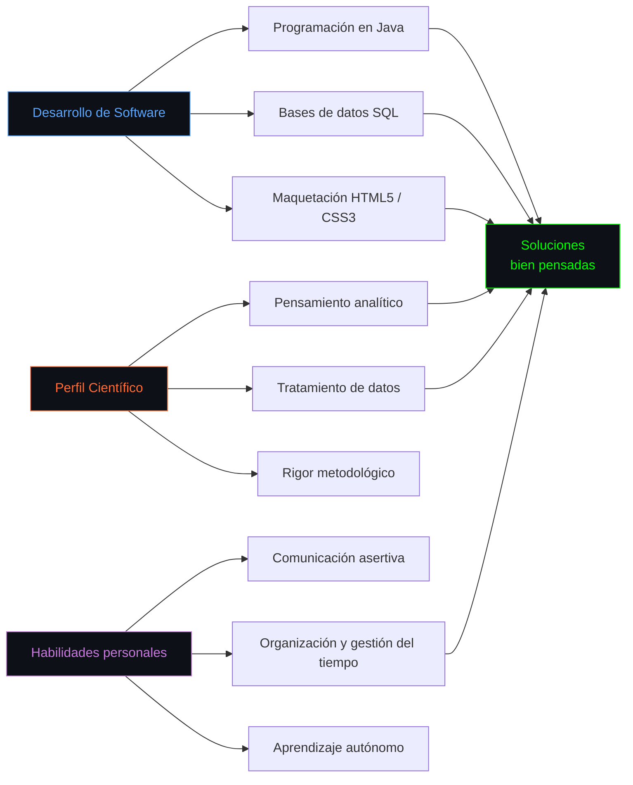

<p align="center">

</p>
<p align="center">
  
</p>

<p align="center">
  <a href="https://github.com/ari2dev?tab=followers">
    
  </a>
  &nbsp;&nbsp;
  <a href="https://github.com/ari2dev?tab=repositories">
    
  </a>
</p>

<div align="center">

<a href="https://github.com/ari2dev">
  
</a>

</div>

<!-- ━━━━━━━━━━━━━━━━━━━━━━━━━━━━━━━━━━━━━━━━━━━━━━━━━━━━━━━━ -->


<p align="center">
 
</p>

<!-- ━━━━━━━━━━━━━━━━━━━━━━━━━━━━━━━━━━━━━━━━━━━━━━━━━━━━━━━━ -->

##  Sobre mí

<p align="center">
  <picture>
    <source media="(prefers-color-scheme: light)" srcset="https://www.gitskins.com/api/section/about?username=ari2dev&theme=github-dark&mode=light" />
    
  </picture>
</p>

<div align="left">

```java
public class Ariadna {

    String nombre = "Ariadna Galván Navarro";
    String rol = "Software Developer | Backend & Web";
    String estudios = "DAM · IES Lomo de la Herradura";
    String idiomas = "Español e inglés (B1)";

    String[] backend = {
        "PHP",
        "Laravel",
        "Node.js",
        "Java"
    };

    String[] basesDeDatos = {
        "SQL",
        "MySQL",
        "PostgreSQL",
        "MongoDB"
    };

    String[] desarrolloWeb = {
        "HTML5",
        "CSS3",
        "APIs REST"
    };

    String[] herramientas = {
        "Git",
        "GitHub",
        "Linux"
    };

    String[] competencias = {
        "Programación orientada a objetos",
        "Lógica de negocio",
        "Operaciones CRUD",
        "Consultas y modelado de datos",
        "Desarrollo e integración de APIs",
        "Depuración y resolución de problemas",
        "Control de versiones",
        "Aprendizaje autónomo"
    };
}
```

```
Estudiante de Desarrollo de Aplicaciones Multiplataforma con una sólida base
científica tras varios años de Biología. Responsable, organizada y con gran
capacidad de aprendizaje. Mi formación me ha dado pensamiento analítico,
rigor metodológico y capacidad para resolver problemas bajo presión.
```

</div>

<p align="center">
  
</p>

<!-- ━━━━━━━━━━━━━━━━━━━━━━━━━━━━━━━━━━━━━━━━━━━━━━━━━━━━━━━━ -->

##  Stack tecnológico

<p align="center">
  <picture>
    <source media="(prefers-color-scheme: light)" srcset="https://www.gitskins.com/api/section/stack?username=ari2dev&theme=github-dark&mode=light" />
    
  </picture>
</p>

<div align="center">

#### Lenguajes

<p>
  
</p>


#### Bases de datos
<p>
  
</p>


### Desarrollo web

<p>
  
</p>


#### Herramientas

<p>
  
</p>


<p align="center">
  
</p>

<!-- ━━━━━━━━━━━━━━━━━━━━━━━━━━━━━━━━━━━━━━━━━━━━━━━━━━━━━━━━ -->

## Mapa de competencias



<p align="center">
  
</p>


<!-- ━━━━━━━━━━━━━━━━━━━━━━━━━━━━━━━━━━━━━━━━━━━━━━━━━━━━━━━━ -->

## Abierta a colaboración

<table width="100%">
  <tr>
    <td align="center" width="25%">
      
      <br><br>
      <strong>Backend</strong>
      <br><br>
      PHP · Laravel<br>
      Node.js · Java<br>
      Lógica de negocio
    </td>
    <td align="center" width="25%">
      
      <br><br>
      <strong>Bases de datos</strong>
      <br><br>
      MySQL · PostgreSQL<br>
      MongoDB · SQL<br>
      Gestión de datos
    </td>
    <td align="center" width="25%">
      
      <br><br>
      <strong>Desarrollo web</strong>
      <br><br>
      HTML5 · CSS3<br>
      Aplicaciones web<br>
      Integración de servicios
    </td>
    <td align="center" width="25%">
      
      <br><br>
      <strong>Herramientas</strong>
      <br><br>
      Git · GitHub<br>
      Trabajo colaborativo<br>
      Mejora continua
    </td>
  </tr>
</table>

Estoy interesada en **prácticas, oportunidades junior y proyectos de desarrollo de software** en los que pueda aplicar mis conocimientos, colaborar con otros desarrolladores y seguir creciendo profesionalmente.

Me interesan especialmente el desarrollo backend, las aplicaciones web, las APIs y la gestión de bases de datos.

<p align="center">
  
</p>

---

<!-- ━━━━━━━━━━━━━━━━━━━━━━━━━━━━━━━━━━━━━━━━━━━━━━━━━━━━━━━━ -->

## Estadísticas de GitHub

<p align="center">
  <picture>
    <source media="(prefers-color-scheme: light)" srcset="https://www.gitskins.com/api/section/stats?username=ari2dev&theme=github-dark&mode=light" />
    
  </picture>
</p>

<div align="center">


<br>

<picture>
  <source media="(prefers-color-scheme: dark)" srcset="https://github-readme-streak-stats.herokuapp.com/?user=ari2dev&theme=tokyonight&hide_border=true&background=0D1117&stroke=00D9FF&ring=00D9FF&fire=FF6B35&currStreakLabel=00D9FF&cache_bust=5"/>
  
</picture>&nbsp;&nbsp;<picture>
  <source media="(prefers-color-scheme: dark)" srcset="https://github-readme-stats.vercel.app/api/top-langs/?username=ari2dev&layout=compact&theme=tokyonight&hide_border=true&bg_color=0D1117&title_color=00D9FF&text_color=FFFFFF&langs_count=10&cache_bust=5"/>
  
</picture>

</div>

<p align="center">
  
</p>

<!-- ━━━━━━━━━━━━━━━━━━━━━━━━━━━━━━━━━━━━━━━━━━━━━━━━━━━━━━━━ -->
## Terreno 3D de contribuciones

<div align="center">


</div>

<p align="center">
  
</p>

<!-- ━━━━━━━━━━━━━━━━━━━━━━━━━━━━━━━━━━━━━━━━━━━━━━━━━━━━━━━━ -->

## Conecta conmigo

<p align="center">
  <a href="mailto:ariadnagalnav2@gmail.com"></a>&nbsp;
  <a href="https://github.com/ari2dev"></a>&nbsp;
  <a href="https://linkedin.com/in/TU-USUARIO-LINKEDIN"></a>
</p>

---

<div align="center">

> *"Aprender, construir y mejorar cada día."*

<br>


</div>
